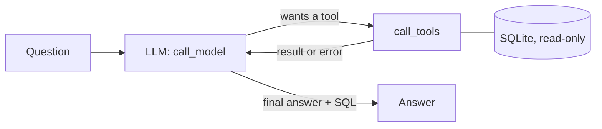

# SQL Analyst Agent

Ask questions about an e-commerce database in plain English. The agent explores the database with
tools, checks real values before filtering on them, writes SQL, fixes its own errors, and shows its work.

**Live demo:** _add your link here_


## How it works



The agent is a loop: the LLM decides which tool to call, the code runs it, and the result goes back
to the LLM until it can answer. It is built twice: once as a hand-written loop (`src/agent.py`) and
once as a LangGraph graph (`src/graph_agent.py`), traced with Langfuse.

| Tool | Purpose |
|---|---|
| `list_tables` | See which tables exist and how big they are |
| `describe_table` | Column names, types and example rows |
| `get_distinct_values` | The values actually stored in a column, so filters use the real spelling |
| `run_query` | Run one read-only `SELECT`; errors are returned to the agent so it can fix the query |

Safety: the database is opened read-only, every query is stopped after 15 seconds, API calls time
out after 60 seconds, and the public demo limits questions per hour.

## Evaluation

`src/evaluate.py` runs every benchmark question through each system, executes the SQL each system
produced and the hand-checked gold SQL, and compares the results (execution accuracy). Each
question is run 3 times, because LLM output varies between runs.

Systems compared:
- **one_shot**: one LLM call with the schema in the prompt (`src/ask.py`)
- **agent_loop**: the tool-using agent, hand-written loop
- **langgraph**: the same agent built with LangGraph

To check whether results depend on the model having memorised this public dataset, the benchmark
was also run on a disguised copy of the database (`scripts/obfuscate.py`) with renamed tables,
columns and status codes (`orders` → `purchases`, `canceled` → `CXL`). The data is identical.

### Results (20 questions × 3 runs)

| System | Real database | Disguised database | Avg time per question |
|---|---|---|---|
| one_shot | 92% | 92% | ~3 s |
| agent_loop | 100% | 100% | ~9–14 s |
| langgraph | 100% | 100% | ~8–13 s |

<!-- TODO (write this yourself): What do these numbers mean? Cover:
     - The two kinds of question one_shot fails on, with one example of each (e2, h4).
     - Why the agent doesn't fail on them (which tool or behaviour fixes each).
     - What the disguised-database test showed, including that the prediction was wrong.
     - The trade-off: accuracy vs about 3-4x more time and LLM calls. -->

### Limitations

<!-- TODO (write this yourself), e.g.:
     - Only 20 questions; the gap is 1-2 questions.
     - One dataset and one model.
     - Renaming only partly hides the dataset from the model.
     - Bugs found in the grader along the way, and how they were fixed. -->

## Run it locally

```bash
python -m venv .venv
.venv\Scripts\activate            # Windows (Mac/Linux: source .venv/bin/activate)
pip install -r requirements.txt
```

Download the [Olist dataset](https://www.kaggle.com/datasets/olistbr/brazilian-ecommerce) into
`data/raw/`, then:

```bash
python scripts/load_data.py                      # build data/olist.db
echo ANTHROPIC_API_KEY=sk-ant-... > .env         # add your key (Langfuse keys optional)
uvicorn api:app --app-dir src --reload           # open http://localhost:8000
```

Other entry points:

```bash
python src/ask.py "How many orders were delivered?"        # one-shot
python src/agent.py "How many orders were cancelled?"      # agent, hand-written loop
python src/graph_agent.py "How many orders were cancelled?" # agent, LangGraph
python src/evaluate.py --runs 3 --workers 2                 # benchmark
python scripts/obfuscate.py                                 # build the disguised database
python src/evaluate.py --obfuscated --runs 3 --workers 2   # benchmark on it
```

## Project structure

```
benchmark/      questions.json (gold SQL), questions_obf.json (generated)
deploy/         compressed demo database for the Docker image
scripts/        load_data.py, obfuscate.py, make_demo_db.py
src/            schema.py, ask.py, tools.py, agent.py, graph_agent.py, evaluate.py, api.py
web/            index.html (the chat page)
Dockerfile
```

## Stack

Python · Claude API · LangGraph · Langfuse · SQLite · FastAPI · Docker
